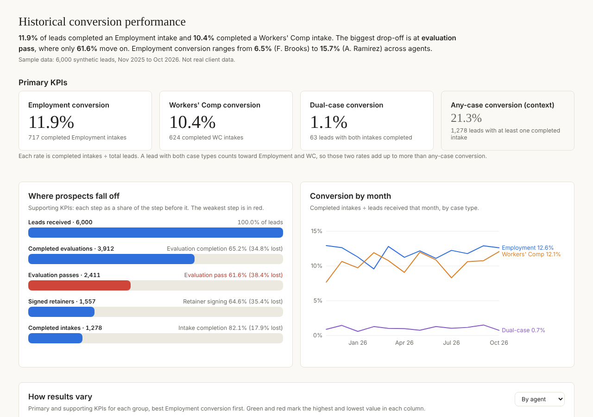

# Lead Conversion Dashboard

**[Open the live dashboard](https://emil-eminov.github.io/sales-conversion-dashboard/)**


A historical conversion dashboard for an intake funnel with two case types (Employment and Workers' Compensation). It answers three questions: how many leads convert, where in the funnel they are lost, and which agents, channels and sources convert best.

All data is **synthetic** (6,000 leads, Nov 2025 to Oct 2026), generated by a seeded script so every number is reproducible. It is not client data.



## Headline numbers (sample data)

| KPI | Value |
|---|---|
| Employment conversion | 11.9% (717 intakes) |
| Workers' Comp conversion | 10.4% (624 intakes) |
| Dual-case conversion | 1.1% (63 leads) |
| Any-case conversion | 21.3% (1,278 leads) |

Funnel: 6,000 leads > 3,912 evaluated (65.2%) > 2,411 passed (61.6%) > 1,557 signed (64.6%) > 1,278 intakes (82.1%). The evaluation pass rate is the weakest step, and the dashboard flags it automatically.

## What is in the page

- **Primary KPI cards** with counts, and a note on why Employment plus WC adds up to more than any-case conversion.
- **Funnel drop-off chart** that colours the weakest step red.
- **Monthly conversion trend** by case type.
- **Breakdown table** by agent, channel or source (dropdown), with the best and worst value in each column highlighted.
- **Metric definitions** for every KPI, written as numerator over denominator.

## How it is built

| File | Role |
|---|---|
| `generate_sample_leads.py` | Generates the 6,000 leads with numpy and pandas (seed 42). Agent, channel and source effects, plus a mild monthly trend, are baked in so the breakdowns have real structure to find. |
| `dashboard_page.html` | The dashboard source: layout, KPI calculations and d3 charts. |
| `build_standalone.py` | Inlines the page, the CSV and d3 into one self-contained HTML file that opens offline. |
| `verify_kpis.py` | Recomputes every headline KPI straight from the CSV with pandas, so the JavaScript numbers are checked against an independent calculation. |
| `docs/index.html` | The built dashboard, served by GitHub Pages. |

```bash
python generate_sample_leads.py          # writes sales_leads_synthetic.csv
python verify_kpis.py                    # independent KPI check
python build_standalone.py dashboard_page.html sales_leads_synthetic.csv d3.min.js docs/index.html
```

`d3.min.js` is the d3 v7 build from [d3js.org](https://d3js.org) or `npm pack d3@7`.
